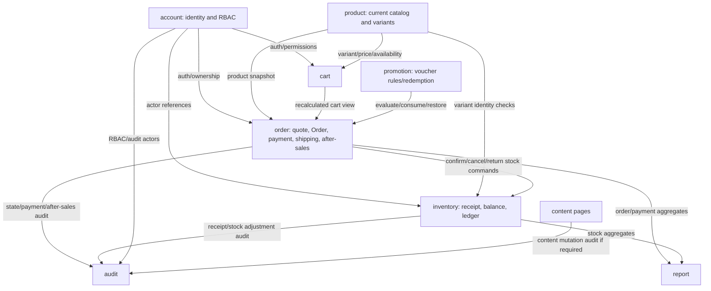

# P0 — Module Dependency Map and Refactor Order

Baseline: `demo1` / `22bd3d887cef3c077e714e5ec21e70ba89855d46`. This is a source/document-based logical graph, not a verified runtime call graph; the full recursive path inventory is now verified, but not every service invocation has been runtime-traced.

## Source inventory snapshot (recursive Git tree at the audited SHA)

The complete, non-truncated tree contains 651 files overall and 260 Java files under `backend/src/main/java/com/fido/modules/`. The counts below are Java file-path counts by package folder, not counts of runtime beans or business use cases. `entity` includes two composite-ID types; `repository` includes read-model view types; `service` includes service-related helper/contract types.

| Module | Module Java files | entity folder | repository folder | service folder | controller folder | dto folder |
|---|---:|---:|---:|---:|---:|---:|
| account | 54 | 8 | 6 | 12 | 5 | 22 |
| audit | 11 | 1 | 1 | 7 | 1 | 1 |
| cart | 12 | 2 | 2 | 3 | 1 | 4 |
| content | 10 | 1 | 1 | 2 | 1 | 4 |
| inventory | 38 | 5 | 6 | 11 | 3 | 12 |
| order | 51 | 5 | 5 | 16 | 4 | 20 |
| product | 66 | 8 | 9 | 19 | 3 | 26 |
| promotion | 9 | 2 | 2 | 2 | 1 | 2 |
| report | 9 | 0 | 1 | 2 | 1 | 5 |
| **Total** | **260** | **32** | **33** | **74** | **20** | **96** |

The tree contains 84 Java files under `backend/src/test/java/`, including test support/helper classes. There are exactly six active Flyway migrations under `backend/src/main/resources/db/migration/` (V1–V6). The 77 numbered rows in `docs/04-api-contract.md` were counted separately by API owner. The recursive inventory closes the prior path-listing gap; local working-tree state and runtime call graph remain outside this remote inspection.

Baseline: `demo1` / `22bd3d887cef3c077e714e5ec21e70ba89855d46`. This is a source/document-based logical graph, not a verified runtime call graph; exhaustive import graph and tests remain unverified.

## 1. Module ownership

| Module | Current responsibility | Target impact |
|---|---|---|
| `account` | Authentication, profile/address, staff/customer back-office, roles/permissions/RBAC. Six source tables. | Same six target tables; account ownership/identity constraints need API alignment. |
| `product` | Catalog, categories/brands/size/color, products, images and variants. | Largest rewrite: parent/child Products and typed attributes; no ProductVariant, SizeSystem, SizeValue or Color tables. |
| `cart` | Authenticated cart/item query and commands. CartItem currently references `variant_id`. | CartItem references a child Product ID; target requires account ownership and removes quote persistence. |
| `promotion` | Voucher administration/redemption; V5 supports scopes and usage ledger. | VOUCHERS remains, but targeting joins and usage ledger are absent. |
| `order` | Checkout quote, Order creation/transitions, COD/payment, shipping, after-sales. | Order/product IDs, account-owned orders, snapshots, idempotency, refund and shipping shape change; guest placement is out of target scope. |
| `inventory` | Supplier, goods receipt, sellable balance and movement ledger. | New warehouse and composite balance key; product replaces variant and balance meaning changes. |
| `audit` | Audit writes and query. | Description-oriented source contract changes to before/after JSON + correlation ID. |
| `report` | Aggregate reads of current Order/Payment and related data. | Revisit every query against target Order/Payment/Inventory shapes and status formulas. |
| `content` | Public/admin content pages. | `page_code`/published source representation becomes `slug`/status; API compatibility remains. |

Evidence: `docs/02-module-ownership.md`, `backend/ARCHITECTURE.md`, `docs/03-data-model.md`, source entities and services listed in the impact matrix.

## 2. Current logical dependency graph

This represents documented service/query dependencies, not a full source-generated graph. `docs/01-architecture-package-structure.md` prohibits cross-module repository imports and documents the aggregate-only JDBC exception in report. `ArchitectureBoundaryTests` checks dependency rules, but was not executed for this SHA.

## 3. Transaction boundaries to preserve

| Use case | Current evidence | Refactor constraint |
|---|---|---|
| Confirm Order | `OrderActionService` is transactional; obtains locked Order, calls Inventory command service, persists status and audit. Source rules require validating every line and rolling back all changes if any stock is insufficient. | Remap keys without splitting Order + balance + ledger + audit into separate commits. Implement atomic/version-guarded updates, not a plain read-then-write. |
| Cancel Order | `OrderActionService` coordinates status, stock restoration and voucher restore. | Target lacks voucher usage ledger; define supported behavior and ensure retries do not restore twice. |
| Confirm Goods Receipt | `GoodsReceiptService` is transactional, calls inventory commands and audit; repeated confirmation must not receive stock twice. | Map receipt item to target Product/warehouse and retain one-time transition semantics. |
| Manual stock adjustment | `InventoryAdjustmentService` delegates mutation to inventory commands and writes audit transactionally. | Target composite key and ledger idempotency must align; retain the required reason/actor trail in approved target-supported form. |
| Voucher redeem/restore | `VoucherRedemptionService` uses `Propagation.MANDATORY`, locks voucher data and owns consume/restore behavior. | Target omits scope and usage tables. Do not weaken limits/race handling without explicit contract decision. |
| Quote/place Order | `CheckoutQuoteService` stores quote fingerprint/expiry/account/order association; tests cover stale quote, replay, account mismatch and rollback. | Target removes quote persistence while Orders gains `idempotency_key`. A new retry contract must be frozen first. |
| COD/refund | Source Payment tracks due/received/refunded amount and collector/refunder actor/time. | Target payment row does not have refund amount/actor/time. Define behavior rather than silently discard it. |

## 4. Recommended dependency-aware order

P0 does not implement these steps.

1. **P1 contract freeze:** guest Cart/order placement is already resolved as authenticated-only by owner decision 2026-10-05; reconcile legacy JWT-optional annotations. Freeze public Product IDs and attribute/inheritance semantics, stock meaning, voucher scope/usage, quote/idempotency, money/snapshot, payment/refund, shipping, address snapshots and physical SQL details.
2. **Persistence foundation:** freeze the 31-table ERD and physical dictionary; keep the fresh baseline and required seed isolated from the current runtime migration path.
3. **Account/RBAC:** preserve login and server-side permission semantics; align account/address ownership constraints.
4. **Catalog/attributes:** implement Product parent/child, typed option/value model, image ownership, SKU/category checks and public identifier compatibility.
5. **Warehouse/inventory/receiving:** seed required warehouse; implement `(warehouse_id, product_id)`, version/atomic balance changes, movement ledger and receipt idempotency.
6. **Cart/pricing/promotion:** convert Variant references; lock selected attribute contract and the target-supported voucher scope/usage behavior.
7. **Order/Payment/Shipping:** implement approved snapshots, order totals, idempotent create/replay, state transitions and payment/shipping lifecycle.
8. **Audit/report/content:** map structured audit/redaction and reporting formulas to target fields; define content slug/status compatibility.
9. **End-to-end acceptance:** update frontend contracts only after the API is frozen; test catalog → cart → quote → order → stock confirmation → COD/shipping and admin/report/audit.

## 5. Dependency gates

- Product and attribute contracts precede Cart/Order because APIs currently expose Variant/Size/Color identity.
- Stock/ledger semantics precede Order confirmation, cancellation, returns, Goods Receipt and report updates.
- Voucher scope/limits precede checkout and cancellation restoration.
- Order snapshots/payment/shipping decisions precede API DTO and report query changes.
- ERD v2 changes persistence; it does not by itself authorize public API changes.
- Owner questionnaire working defaults are not proof of integrated behavior; several service/API items remain OPEN.
