# P1 — ERD v2 and Data Contract Status

- Status: PARTIAL — logical schema structure is confirmed; physical SQL and material business/API rules are not frozen.
- Canonical source: docs/refactor/phase-1-erd-v2-approved.mmd, copied verbatim below.
- The source diagram contains 31 tables; P1 keeps the supplied ERD unchanged. Any proposed adjustment is listed separately.

The ERD is the logical schema authority; it does not, by itself, approve physical SQL types/lengths, unspecified nullability, defaults, index coverage, FK delete actions or status domains.

## Canonical ERD v2

```mermaid
%% FIDO ERD v2 — owner-confirmed target model
%% Canonical source: the exact ERD supplied by the project owner on 2026-10-22.
%% This version supersedes the earlier 38-table draft. It contains 31 target tables.
%% Logical ERD: unspecified physical nullability, data lengths, defaults, constraints and status literals must be documented separately.
erDiagram
    ACCOUNTS {
        bigint id PK
        varchar full_name
        varchar email
        varchar phone
        varchar password_hash
        varchar status
        timestamp created_at
        timestamp updated_at
    }

    ADDRESSES {
        bigint id PK
        bigint account_id FK
        varchar recipient_name
        varchar recipient_phone
        varchar province
        varchar district
        varchar ward
        varchar address_line
        boolean is_default
        timestamp created_at
        timestamp updated_at
    }

    ROLES {
        bigint id PK
        varchar code UK
        varchar name
        varchar description
        varchar status
    }

    PERMISSIONS {
        bigint id PK
        varchar code UK
        varchar name
        varchar description
    }

    ACCOUNT_ROLES {
        bigint account_id PK,FK
        bigint role_id PK,FK
    }

    ROLE_PERMISSIONS {
        bigint role_id PK,FK
        bigint permission_id PK,FK
    }

    CATEGORIES {
        bigint id PK
        bigint parent_category_id FK
        varchar name
        varchar slug UK
        varchar status
        timestamp created_at
        timestamp updated_at
    }

    BRANDS {
        bigint id PK
        varchar name
        varchar slug UK
        varchar status
    }

    PRODUCTS {
        bigint id PK
        bigint parent_product_id FK
        bigint category_id FK
        bigint brand_id FK
        varchar name "NULL for child if inherited"
        varchar slug "NULL for child if inherited"
        varchar sku UK
        text description "NULL for child if inherited"
        decimal selling_price "NULL on child means inherit"
        decimal cost_price "Nullable"
        varchar status
        timestamp deleted_at
        timestamp created_at
        timestamp updated_at
    }

    ATTRIBUTE_TYPES {
        bigint id PK
        varchar code UK
        varchar name
        varchar data_type
    }

    ATTRIBUTES {
        bigint id PK
        bigint attribute_type_id FK
        varchar code UK
        varchar name
        boolean is_required
        boolean is_variant_defining
        int sort_order
    }

    ATTRIBUTE_OPTIONS {
        bigint id PK
        bigint attribute_id FK
        varchar value
        varchar label
        int sort_order
    }

    PRODUCT_ATTRIBUTE_VALUES {
        bigint product_id PK,FK
        bigint attribute_id PK,FK
        bigint option_id FK
        varchar text_value
        decimal number_value
        boolean boolean_value
    }

    PRODUCT_IMAGES {
        bigint id PK
        bigint product_id FK
        varchar image_url
        boolean is_primary
        int sort_order
        timestamp created_at
    }

    CARTS {
        bigint id PK
        bigint account_id FK
        varchar status
        timestamp created_at
        timestamp updated_at
    }

    CART_ITEMS {
        bigint id PK
        bigint cart_id FK
        bigint product_id FK
        int quantity
        timestamp added_at
        timestamp updated_at
    }

    VOUCHERS {
        bigint id PK
        varchar code UK
        varchar discount_type
        decimal discount_value
        decimal minimum_order_value
        decimal maximum_discount
        timestamp starts_at
        timestamp ends_at
        int usage_limit
        varchar status
    }

    ORDERS {
        bigint id PK
        bigint account_id FK
        bigint voucher_id FK
        varchar order_number UK
        varchar idempotency_key UK
        varchar status
        decimal subtotal
        decimal discount_amount
        decimal shipping_fee
        decimal total_amount
        varchar currency
        timestamp placed_at
        timestamp created_at
        timestamp updated_at
    }

    ORDER_ITEMS {
        bigint id PK
        bigint order_id FK
        bigint product_id FK
        varchar sku_snapshot
        varchar product_name_snapshot
        varchar attribute_snapshot
        int quantity
        decimal unit_price
        decimal discount_amount
        decimal line_total
    }

    ORDER_ADDRESSES {
        bigint order_id PK,FK
        varchar recipient_name
        varchar recipient_phone
        varchar province
        varchar district
        varchar ward
        varchar address_line
    }

    ORDER_VOUCHER_SNAPSHOTS {
        bigint order_id PK,FK
        varchar voucher_code_snapshot
        varchar discount_type_snapshot
        decimal discount_value_snapshot
        decimal discount_amount_snapshot
    }

    PAYMENTS {
        bigint order_id PK,FK
        varchar method
        varchar payment_status
        decimal amount
        varchar currency
        bigint collected_by_account_id FK
        timestamp collected_at
        timestamp created_at
        timestamp updated_at
    }

    SHIPPING_INFOS {
        bigint order_id PK,FK
        varchar recipient_name
        varchar recipient_phone
        varchar carrier_name
        varchar tracking_number
        varchar shipping_status
        timestamp shipped_at
        timestamp delivered_at
        timestamp updated_at
    }

    SUPPLIERS {
        bigint id PK
        varchar code UK
        varchar name
        varchar phone
        varchar email
        varchar status
        timestamp created_at
        timestamp updated_at
    }

    GOODS_RECEIPTS {
        bigint id PK
        bigint supplier_id FK
        varchar receipt_number UK
        varchar status
        bigint created_by FK
        bigint confirmed_by FK
        timestamp confirmed_at
        timestamp created_at
        timestamp updated_at
    }

    GOODS_RECEIPT_ITEMS {
        bigint id PK
        bigint goods_receipt_id FK
        bigint product_id FK
        int quantity_received
        decimal unit_cost
    }

    WAREHOUSES {
        bigint id PK
        varchar code UK
        varchar name
        varchar status
    }

    INVENTORIES {
        bigint warehouse_id PK,FK
        bigint product_id PK,FK
        int quantity_on_hand
        int version
        timestamp updated_at
    }

    INVENTORY_TRANSACTIONS {
        bigint id PK
        bigint warehouse_id FK
        bigint product_id FK
        varchar transaction_type
        int quantity_delta
        bigint goods_receipt_item_id FK
        bigint order_item_id FK
        varchar idempotency_key UK
        bigint created_by FK
        timestamp created_at
    }

    AUDIT_LOGS {
        bigint id PK
        bigint actor_account_id FK
        varchar action
        varchar entity_type
        varchar entity_id
        json before_data
        json after_data
        varchar correlation_id
        timestamp created_at
    }

    CONTENT_PAGES {
        bigint id PK
        varchar slug UK
        varchar title
        text content
        varchar status
        bigint updated_by FK
        timestamp updated_at
    }

    ACCOUNTS ||--o{ ADDRESSES : owns
    ACCOUNTS ||--o{ ACCOUNT_ROLES : assigned
    ROLES ||--o{ ACCOUNT_ROLES : grants
    ROLES ||--o{ ROLE_PERMISSIONS : contains
    PERMISSIONS ||--o{ ROLE_PERMISSIONS : assigned

    CATEGORIES o|--o{ CATEGORIES : parent_of
    CATEGORIES o|--o{ PRODUCTS : classifies
    BRANDS o|--o{ PRODUCTS : brands

    PRODUCTS o|--o{ PRODUCTS : parent_of
    ATTRIBUTE_TYPES ||--o{ ATTRIBUTES : defines_type
    ATTRIBUTES ||--o{ ATTRIBUTE_OPTIONS : offers
    PRODUCTS ||--o{ PRODUCT_ATTRIBUTE_VALUES : has
    ATTRIBUTES ||--o{ PRODUCT_ATTRIBUTE_VALUES : describes
    ATTRIBUTE_OPTIONS o|--o{ PRODUCT_ATTRIBUTE_VALUES : selected_option
    PRODUCTS ||--o{ PRODUCT_IMAGES : has

    ACCOUNTS ||--o{ CARTS : owns
    CARTS ||--|{ CART_ITEMS : contains
    PRODUCTS ||--o{ CART_ITEMS : selected

    ACCOUNTS ||--o{ ORDERS : places
    VOUCHERS o|--o{ ORDERS : applied
    ORDERS ||--|{ ORDER_ITEMS : contains
    PRODUCTS ||--o{ ORDER_ITEMS : snapshot_source
    ORDERS ||--|| ORDER_ADDRESSES : delivery_snapshot
    ORDERS ||--o| ORDER_VOUCHER_SNAPSHOTS : voucher_snapshot
    ORDERS ||--|| PAYMENTS : cod_payment
    ORDERS ||--o| SHIPPING_INFOS : manual_shipping

    SUPPLIERS o|--o{ GOODS_RECEIPTS : supplies
    ACCOUNTS ||--o{ GOODS_RECEIPTS : creates
    GOODS_RECEIPTS ||--|{ GOODS_RECEIPT_ITEMS : contains
    PRODUCTS ||--o{ GOODS_RECEIPT_ITEMS : received_sku

    WAREHOUSES ||--o{ INVENTORIES : stores
    PRODUCTS ||--o{ INVENTORIES : stock_balance
    WAREHOUSES ||--o{ INVENTORY_TRANSACTIONS : ledger
    PRODUCTS ||--o{ INVENTORY_TRANSACTIONS : movement
    GOODS_RECEIPT_ITEMS o|--o{ INVENTORY_TRANSACTIONS : receipt_source
    ORDER_ITEMS o|--o{ INVENTORY_TRANSACTIONS : order_source
    ACCOUNTS o|--o{ INVENTORY_TRANSACTIONS : records

    ACCOUNTS o|--o{ AUDIT_LOGS : performs
    ACCOUNTS o|--o{ CONTENT_PAGES : updates
```

## Table inventory

1. ACCOUNTS
2. ADDRESSES
3. ROLES
4. PERMISSIONS
5. ACCOUNT_ROLES
6. ROLE_PERMISSIONS
7. CATEGORIES
8. BRANDS
9. PRODUCTS
10. ATTRIBUTE_TYPES
11. ATTRIBUTES
12. ATTRIBUTE_OPTIONS
13. PRODUCT_ATTRIBUTE_VALUES
14. PRODUCT_IMAGES
15. CARTS
16. CART_ITEMS
17. VOUCHERS
18. ORDERS
19. ORDER_ITEMS
20. ORDER_ADDRESSES
21. ORDER_VOUCHER_SNAPSHOTS
22. PAYMENTS
23. SHIPPING_INFOS
24. SUPPLIERS
25. GOODS_RECEIPTS
26. GOODS_RECEIPT_ITEMS
27. WAREHOUSES
28. INVENTORIES
29. INVENTORY_TRANSACTIONS
30. AUDIT_LOGS
31. CONTENT_PAGES

## Cardinality and key review

- Composite keys: ACCOUNT_ROLES(account_id, role_id), ROLE_PERMISSIONS(role_id, permission_id), PRODUCT_ATTRIBUTE_VALUES(product_id, attribute_id), INVENTORIES(warehouse_id, product_id).
- Order-owned one-to-one PK/FK: ORDER_ADDRESSES, ORDER_VOUCHER_SNAPSHOTS, PAYMENTS and optional SHIPPING_INFOS.
- Self references: CATEGORIES.parent_category_id and PRODUCTS.parent_product_id; FK alone does not prevent cycles.
- Target ERD intentionally excludes PRODUCT_VARIANTS, SIZE_SYSTEMS, SIZE_VALUES, COLORS, VOUCHER_PRODUCTS, VOUCHER_CATEGORIES, VOUCHER_USAGES, CHECKOUT_QUOTES and dedicated refund/return/reservation tables.

## Proposals outside the approved diagram

| ID | Proposed adjustment | Reason | Status |
|---|---|---|---|
| P1-PROP-03 | Canonical child-product variant signature with unique scope, or equivalent atomic guard. | SKU uniqueness does not prevent duplicate sets of variant-defining dynamic attributes. | PROPOSED; DB-01/02 |
| P1-PROP-04 | Add GOODS_RECEIPTS.warehouse_id or explicitly assign a default single warehouse in the owner service. | Receipt does not persist its destination. | PROPOSED; DB-03 |
| P1-PROP-05 | Persist adjustment reason in INVENTORY_TRANSACTIONS or approve another searchable/auditable contract. | Current adjustment request requires reason; target ledger has no reason column. | PROPOSED; DB-03 |
| P1-PROP-06 | Add ORDER_ITEMS.image_url_snapshot or approve no historical-image guarantee. | Existing Order DTO expects historical image; target ERD omits it. | PROPOSED; DB-07 |
| P1-PROP-07 | Define source/type/sign/reversal guards for inventory movements. | Draft movement types do not fully define cancellation/restock reversals. | PROPOSED; DB-03/08 |
| P1-PROP-08 | Resolve OrderAddress snapshot mutability and duplicate receiver fields in ShippingInfo. | Source currently allows recipient updates through PREPARING. | PROPOSED; DB-07/08 |
| P1-PROP-09 | Approve reduced voucher scope, defer redemption, or amend ERD to restore scope/usage persistence. | Existing voucher contract is richer than target schema. | PROPOSED; DB-06 |
| P1-PROP-10 | Approve full-refund-only semantics, add refund persistence, or defer refunds. | Target Payment omits refunded amount/actor/time. | PROPOSED; DB-08 |
| P1-PROP-11 | Approve physical column/default/nullability/domain/index/FK contract. | Current DDL values remain working choices. | PROPOSED; DB-09 |

## Freeze conclusion

Only logical structure can be called confirmed. Do not call the complete data contract frozen until DB-01, DB-02, DB-03, DB-05, DB-06, DB-07, DB-08 and DB-09 are resolved or formally excluded by the owner. A-03 already resolves authenticated-only Cart/Order; guest checkout is not an active blocker.
